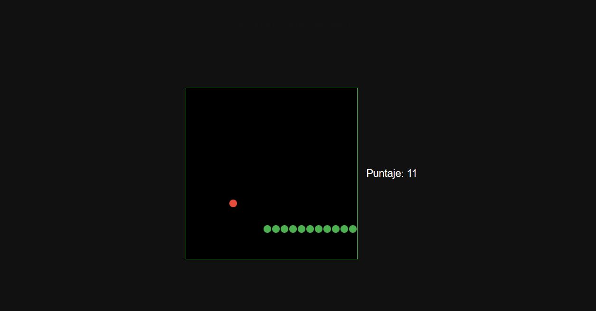

# Snake

El clásico juego de la serpiente, hecho con TypeScript y la API Canvas del navegador, sin librerías ni frameworks.



## Cómo se juega

- Las **flechas** del teclado mueven la serpiente. El juego arranca con la primera flecha que se aprieta.
- Cada vez que come, la serpiente crece y suma un punto.
- Se pierde al chocar contra un borde o contra el propio cuerpo.
- **R** reinicia la partida.
- No se puede girar 180° de golpe, para evitar chocarse con uno mismo por accidente.

## Tecnologías

- TypeScript compilado a JavaScript para el navegador
- HTML5 Canvas para dibujar
- Sin dependencias de ejecución: solo TypeScript como herramienta de desarrollo

## Cómo correrlo

Necesitás tener [Node.js](https://nodejs.org/) instalado.

```bash
git clone https://github.com/lunati-luna/snake-canvas.git
cd snake-canvas
npm install
npx tsc
```

El comando `npx tsc` compila `src/game.ts` y genera `dist/game.js`. Después abrí `index.html` en el navegador (doble click, o con la extensión Live Server de VS Code).

## Estructura

```
├── index.html      # Página con el canvas y el puntaje
├── src/
│   └── game.ts     # Toda la lógica del juego
└── tsconfig.json   # Configuración del compilador (destino: navegador)
```

## Qué practiqué en este proyecto

- Dibujar en un `<canvas>` y convertir posiciones de una grilla a píxeles.
- Un loop de juego con `setInterval` y `clearInterval`.
- Eventos de teclado con `addEventListener` y `switch`.
- Manejo de estado (serpiente, dirección, comida) y su reinicio sin dejar loops duplicados.
- Colisiones con `.some()`, y tipos como `interface`, tipos unión (`Punto | null`) y `as`.